<div align="center">

<!-- Phase 1: Interactive Animated Terminal Banner -->
<picture>
  <source media="(prefers-color-scheme: dark)" srcset="https://raw.githubusercontent.com/dheeraj0204/dheeraj0204/main/dark.svg" />
  <source media="(prefers-color-scheme: light)" srcset="https://raw.githubusercontent.com/dheeraj0204/dheeraj0204/main/light.svg" />
  
</picture>

<br/><br/>

<!-- Phase 4: Social Badges -->
<a href="https://www.linkedin.com/in/dheeraj-khetwal" target="_blank">
  
</a>
&nbsp;&nbsp;
<a href="https://www.instagram.com/dheerajj.tech" target="_blank">
  
</a>
&nbsp;&nbsp;
<a href="mailto:dheerajkhetwal1599@gmail.com">
  
</a>
&nbsp;&nbsp;
<a href="https://github.com/dheeraj0204">
  
</a>

<br/><br/>

<!-- Phase 2: Streak & Stats Cards -->


<br/>


<br/><br/>

<!-- Phase 3: Contribution Snake Animation -->
<picture>
  <source media="(prefers-color-scheme: dark)" srcset="https://raw.githubusercontent.com/dheeraj0204/dheeraj0204/output/github-snake-dark.svg" />
  <source media="(prefers-color-scheme: light)" srcset="https://raw.githubusercontent.com/dheeraj0204/dheeraj0204/output/github-snake.svg" />
  
</picture>

</div>

---

### 🧬 Developer Identity

> **AI/ML Engineer in the making.**  
> *Building intelligent systems where AI meets scalable engineering.*

Computer Science (AI & ML) engineer focused on **AI engineering**, **scalable AI systems**, **high-performance software**, **quantitative problem solving**, and **data-driven engineering**.  
Core Focus: **AI/ML + Software Engineering + Agentic AI Architecture**.

---

### ⚡ Engineering Impact
*Data-driven telemetry across production platforms, research systems, and community initiatives.*

<table>
  <tr>
    <td align="center" width="25%">
      <h2 style="margin: 0; color: #22D3EE;">10,000+</h2>
      <b>Concurrent Users</b><br/>
      <sub>eHRMS Platform Scale</sub>
    </td>
    <td align="center" width="25%">
      <h2 style="margin: 0; color: #10B981;">99.5%</h2>
      <b>Uptime Reliability</b><br/>
      <sub>Production Governance</sub>
    </td>
    <td align="center" width="25%">
      <h2 style="margin: 0; color: #A78BFA;">92%</h2>
      <b>Anomaly Accuracy</b><br/>
      <sub>Rail Suraksha Computer Vision</sub>
    </td>
    <td align="center" width="25%">
      <h2 style="margin: 0; color: #38BDF8;">60%</h2>
      <b>Faster Resolution</b><br/>
      <sub>AI NLP Query Pipeline</sub>
    </td>
  </tr>
  <tr>
    <td align="center" width="25%">
      <h2 style="margin: 0; color: #F59E0B;">5,000+</h2>
      <b>Farmers Served</b><br/>
      <sub>Kisan Saathi Multilingual AI</sub>
    </td>
    <td align="center" width="25%">
      <h2 style="margin: 0; color: #EC4899;">95%</h2>
      <b>Satisfaction Rate</b><br/>
      <sub>Agri-Tech User Validation</sub>
    </td>
    <td align="center" width="25%">
      <h2 style="margin: 0; color: #22D3EE;">5+</h2>
      <b>AI/ML Models</b><br/>
      <sub>85%+ Real-World Accuracy</sub>
    </td>
    <td align="center" width="25%">
      <h2 style="margin: 0; color: #10B981;">5,000+</h2>
      <b>Engineers Reached</b><br/>
      <sub>4 Hackathons & 10+ Workshops</sub>
    </td>
  </tr>
</table>

---

### 🧠 Building the Next Generation of AI Systems
*Architecting autonomous, tool-augmented, multi-agent intelligence pipelines.*

```
┌─────────────────┐      ┌─────────────────┐      ┌─────────────┐      ┌─────────────────────────┐
│       LLM       │ ───► │  Tool Calling   │ ───► │     RAG     │ ───► │    Vector Databases     │
│ (Reasoning Core)│      │(External Tools) │      │ (Context)   │      │   (Pinecone / Chroma)   │
└─────────────────┘      └─────────────────┘      └─────────────┘      └────────────┬────────────┘
                                                                                    │
┌─────────────────────────┐      ┌─────────────────┐      ┌─────────────────────────▼────────────┐
│    Autonomous Action    │ ◄─── │    LangGraph    │ ◄─── │       LangChain & Multi-Agent        │
│  & Automated Reporting  │      │  (State Graph)  │      │       Orchestration Pipeline         │
└─────────────────────────┘      └─────────────────┘      └──────────────────────────────────────┘
```

<div align="center">


</div>

---

### 🛠️ Tech Arsenal

<table>
  <tr>
    <td width="50%" valign="top">
      <h4><code>01 — LANGUAGES</code></h4>
      <a href="https://skillicons.dev">
        
      </a>
      <br/><br/>
      <code>Python</code> • <code>Java</code> • <code>JavaScript</code> • <code>SQL</code>
    </td>
    <td width="50%" valign="top">
      <h4><code>02 — AI / MACHINE LEARNING</code></h4>
      <a href="https://skillicons.dev">
        
      </a>
      <br/><br/>
      <code>TensorFlow</code> • <code>scikit-learn</code> • <code>OpenCV</code> • <code>CNN / YOLO</code> • <code>Machine Learning</code>
    </td>
  </tr>
  <tr>
    <td width="50%" valign="top">
      <h4><code>03 — AGENTIC AI &amp; SYSTEM ARCHITECTURE</code></h4>
      
      
      <br/>
      
      
      <br/><br/>
      <code>Multi-Agent Orchestration</code> • <code>Tool Calling</code> • <code>RAG</code> • <code>Vector DBs</code>
    </td>
    <td width="50%" valign="top">
      <h4><code>04 — ENGINEERING &amp; PLATFORMS</code></h4>
      <a href="https://skillicons.dev">
        
      </a>
      <br/><br/>
      <code>React</code> • <code>Flask</code> • <code>Docker</code> • <code>Vercel</code> • <code>Firebase</code> • <code>REST APIs</code> • <code>DSA &amp; OOP</code>
    </td>
  </tr>
</table>

---

### 🚀 Featured Projects

<table>
  <tr>
    <td width="100%">
      <h3>⭐ AutoOps AI — Multi-Agent Autonomous Infrastructure Monitor</h3>
      <p><i>Multi-agent autonomous infrastructure monitoring system combining Computer Vision with LLM-based reasoning agents to detect infrastructure anomalies from real-time feeds without manual intervention.</i></p>
      <p>
        
        
        
        
        
        
      </p>
      <b>Architecture Visual Flow:</b><br/>
      <code>📹 Real-time Feed</code> ➔ <code>👁️ Perception Agent</code> ➔ <code>🧠 Reasoning Agent</code> ➔ <code>⚡ Action Agent</code> ➔ <code>🚨 Alert + 📄 PDF Report</code>
      <br/><br/>
      <ul>
        <li><b>Autonomous Pipeline:</b> LangGraph orchestrates distributed perception, reasoning, and action agents.</li>
        <li><b>Impact:</b> Eliminates manual monitoring by triggering automated alerts and diagnostic PDF reports in real time.</li>
      </ul>
      <a href="#"><b>[Live Demo]</b></a>
    </td>
  </tr>
</table>

<br/>

<table>
  <tr>
    <td width="50%" valign="top">
      <h3>⭐ eHRMS – Manav Sampada</h3>
      <p><i>Enterprise-scale redesigned government HRMS platform featuring payroll management, compliance verification, and an AI-powered conversational HR engine.</i></p>
      <p>
        
        
        
        
        
      </p>
      <b>Key Telemetry:</b>
      <ul>
        <li>⚡ <b>10,000+ Concurrent Users</b> supported concurrently</li>
        <li>🟢 <b>99.5% System Uptime</b> achieved in production</li>
        <li>🚀 <b>60% Faster</b> HR query resolution via NLP chatbot</li>
      </ul>
      <a href="#"><b>[Live Demo]</b></a>
    </td>
    <td width="50%" valign="top">
      <h3>⭐ Rail Suraksha Assistant</h3>
      <p><i>AI-based predictive railway safety monitoring system using computer vision and deep learning to inspect track integrity and flag potential hazards.</i></p>
      <p>
        
        
        
        
        
      </p>
      <b>Key Telemetry:</b>
      <ul>
        <li>🏆 <b>2nd Place — RailHack Hackathon</b> (National Level)</li>
        <li>🎯 <b>92% Anomaly Detection Accuracy</b> on railway track defects</li>
        <li>👥 Competed against <b>200+ engineering teams</b> nationwide</li>
      </ul>
      <a href="#"><b>[Live Demo]</b></a>
    </td>
  </tr>
  <tr>
    <td colspan="2" valign="top">
      <h3>⭐ Kisan Saathi — Multilingual AI Agri-Advisor</h3>
      <p><i>AI-driven agricultural advisory chatbot delivering localized weather intelligence, crop guidance, and government scheme awareness directly to farming communities.</i></p>
      <p>
        
        
        
        
        
      </p>
      <b>Key Telemetry:</b>
      <ul>
        <li>🌾 <b>5,000+ Farmers</b> onboarded and actively assisted</li>
        <li>🌐 <b>Bilingual Support</b> in Hindi &amp; English for seamless accessibility</li>
        <li>❤️ <b>95% Farmer Satisfaction</b> rate across real field trials</li>
      </ul>
      <a href="#"><b>[Live Demo]</b></a>
    </td>
  </tr>
</table>

---

### 💼 Experience &amp; Leadership

<table>
  <tr>
    <td width="50%" valign="top">
      <h4>🤖 Artificial Intelligence Intern</h4>
      <b>Wayspire EdTech Pvt. Ltd.</b> • <i>Aug 2024 – Oct 2024</i>
      <br/><br/>
      <ul>
        <li>Engineered and benchmarked <b>5+ production AI/ML models</b> utilizing Python, scikit-learn, and TensorFlow.</li>
        <li>Attained <b>85%+ predictive accuracy</b> on real-world industry datasets.</li>
        <li>Integrated AI inference pipelines into production workflows and collaborated cross-functionally with core engineering teams.</li>
      </ul>
      <p>
        
        
      </p>
    </td>
    <td width="50%" valign="top">
      <h4>🚀 Campus Leadership &amp; Community</h4>
      <b>Amrapali University</b> • <i>Nov 2024 – Present</i>
      <br/>
      <sub>Google Gemini Student Ambassador • GeeksforGeeks Campus Mantri • Tech Club Lead</sub>
      <br/><br/>
      <ul>
        <li>Spearheaded <b>4 large-scale hackathons</b> with <b>5,000+ total participants</b>.</li>
        <li>Conducted <b>10+ technical workshops</b> on AI/ML, reaching over <b>2,000+ students</b>.</li>
        <li>Drove a <b>3x surge</b> in campus-wide competitive programming and hackathon participation.</li>
      </ul>
      <p>
        
        
        
      </p>
    </td>
  </tr>
</table>

---

### 🏆 Achievements &amp; Recognition

<table>
  <tr>
    <td width="25%" align="center">
      <h3>🏆 Winner</h3>
      <b>IDE Bootcamp 2026</b><br/>
      <sub>AICTE &amp; MoE Innovation Cell<br/>Government of India</sub>
    </td>
    <td width="25%" align="center">
      <h3>🥇 1st Place</h3>
      <b>Startup Uttarakhand</b><br/>
      <sub>Grand Challenge 2025<br/>State Entrepreneurship</sub>
    </td>
    <td width="25%" align="center">
      <h3>🥈 2nd Place</h3>
      <b>RailHack Hackathon</b><br/>
      <sub>AI/ML Track<br/>200+ Nationwide Teams</sub>
    </td>
    <td width="25%" align="center">
      <h3>🥉 3rd Place</h3>
      <b>Startup Genesis</b><br/>
      <sub>State-level Startup<br/>Pitch Competition</sub>
    </td>
  </tr>
</table>

---

### 🎓 Education

<table>
  <tr>
    <td width="60%" valign="top">
      <h4>🏛️ Amrapali University</h4>
      <b>Bachelor of Technology in Computer Science (AI &amp; ML)</b><br/>
      <i>Aug 2024 – May 2028</i><br/>
      <code>CGPA: 7.4 / 10.0</code>
    </td>
    <td width="40%" valign="top">
      <h4>🏫 Arden Progressive School</h4>
      <i>2021 – 2023</i><br/>
      • <b>CBSE Class XII:</b> <code>81.0%</code><br/>
      • <b>CBSE Class X:</b> <code>96.6%</code>
    </td>
  </tr>
</table>

---

### 🔭 What I'm Building
*Focused research and engineering vectors:*

- 🔷 **Agentic AI &amp; Multi-Agent Systems** — Autonomous workflows orchestrated with LangGraph and tool-calling agents.
- 🟣 **AI Infrastructure Telemetry** — Real-time anomaly detection pipelines combining Computer Vision with reasoning LLMs.
- 🟢 **Enterprise RAG Architectures** — Low-latency retrieval over hybrid vector embeddings (Pinecone / ChromaDB).
- ⚡ **Scalable Edge &amp; Cloud ML Systems** — Containerized microservices optimized for high-throughput production inference.

---

### 💻 AI Engineer Terminal

```bash
┌────────────────────────────────────────────────────────────────────────┐
│ dheeraj@ai-lab:~$ whoami                                               │
│                                                                        │
│ Dheeraj Khetwal — AI/ML Engineer                                       │
│ Agentic AI • Multi-Agent Systems • Computer Vision • Scalable Software │
│                                                                        │
│ dheeraj@ai-lab:~$ cat skills.json | jq '.specialization'               │
│ [ "LangGraph", "LangChain", "RAG", "TensorFlow", "Computer Vision" ]   │
│                                                                        │
│ dheeraj@ai-lab:~$ status                                               │
│ [████████████████████████████████████████] 100% BUILDING               │
└────────────────────────────────────────────────────────────────────────┘
```

---

<div align="center">

### 🤝 Let's Build Something Intelligent

*Open to AI/ML Engineering roles, Agentic AI research collaborations, and scalable software initiatives.*

<a href="https://www.linkedin.com/in/dheeraj-khetwal" target="_blank">
  
</a>
&nbsp;&nbsp;
<a href="https://github.com/dheeraj0204" target="_blank">
  
</a>
&nbsp;&nbsp;
<a href="mailto:dheerajkhetwal1599@gmail.com">
  
</a>
&nbsp;&nbsp;
<a href="https://www.instagram.com/dheerajj.tech" target="_blank">
  
</a>

<br/><br/>

<sub>Designed with high precision for GitHub • Engineered by <b>Dheeraj Khetwal</b></sub>

</div>